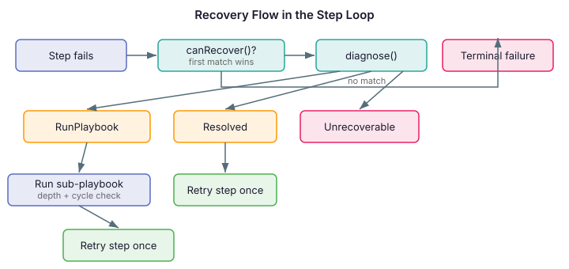

# The Playbook Runner Learned to Recover

The playbook runner had a blind spot: every failure was terminal. A step fails, the loop breaks, the playbook is done. For transient errors that's fine — the `retry:` decorator handles those. But `require-capability` failures are different. They're structural. The capability isn't missing because of a timeout; it's missing because nobody configured the SMS provider yet. And crucially, the failure itself carries the instructions for fixing the problem — which provider to set up, which setup playbook to run.

The runner was ignoring all of that and just dying.

## Recovery Is Not Retry

I wanted to get this right at the foundation level. The temptation was to special-case `"unmet-requirement"` in the step loop — check the category, run the setup playbook, retry. But that's a hack that bakes one failure type into the runner's core loop, and the next recoverable failure type would need another special case.

The real question was: what does a general recoverable failure mechanism look like? Recovery is fundamentally different from retry. Retry re-executes the same step hoping for a different outcome. Recovery changes the world — configures a provider, runs a setup playbook, creates a resource — then re-executes the step expecting it to succeed because the environment is now different.

Claude and I explored three architectural models. The one that stuck was the command pattern: handlers analyse failures and return *instructions* (`RunPlaybook`, `Resolved`, `Unrecoverable`). The runner executes the instructions. This avoids a circular dependency that would have emerged if handlers needed the runner to run sub-playbooks, and it keeps depth limits and cycle detection in one place — the runner.



## The SPI

```java
public interface FailureRecoveryHandler {
    boolean canRecover(Result.Failure failure);
    RecoveryAction diagnose(Result.Failure failure, RecoveryContext context);
}
```

`canRecover` is a cheap filter — typically a string comparison on `failure.category()`. `diagnose` does the real work: examines the failure's detail map and returns an instruction. The handler never executes anything. It's a pure function from failure to recovery action, which makes it trivially testable without mocking.

The `RecoveryAction` sealed interface has three variants:

```java
public sealed interface RecoveryAction {
    record RunPlaybook(String playbookPath, Map<String, Object> vars)
        implements RecoveryAction {}
    record Resolved(String explanation) implements RecoveryAction {}
    record Unrecoverable(String reason, Map<String, Object> enrichedDetail)
        implements RecoveryAction {}
}
```

`RunPlaybook` is the interesting one. The runner resolves the path against `resourceRoot`, checks for cycles (a setup playbook that requires the capability its own setup provides), runs the sub-playbook, and retries the original step once. One shot — if the retry still fails after recovery changed the world, something is fundamentally wrong and retrying again won't help.

## Depth and Cycles

Recursive recovery needs guardrails. A setup playbook can itself contain a `require-capability` step that triggers another setup playbook. Without limits, this chains infinitely.

`RecoveryState` is an immutable record threaded through recursive `runInternal` calls. It tracks depth (capped at 3: main → setup → setup's dependency) and a set of normalised playbook paths for cycle detection. The `descend()` method returns a new state with depth + 1 and the current playbook added to the chain — stack-safe, no mutation. If `wouldCycle()` returns true, recovery stops immediately with a "circular recovery" error rather than looping.

## What Manual Resolution Looks Like

Not every unmet requirement has a setup playbook. Some capabilities require manual human configuration — API keys, external service accounts, things the runner can't automate. The handler returns `Unrecoverable` with enriched detail containing the manual options. The playbook fails, but the caller (MCP tool, REST endpoint) gets enough information to present the user with specific options rather than a generic error message.

The runner handles what it can automatically. The caller handles the rest. Clean boundary.

The question of where the architecture sits in the stack — top-level steps only, not nested inside blocks or try-catch — was a deliberate constraint. `require-capability` is a prerequisite guard. It belongs at the top of a playbook, not buried inside conditional logic. If a future use case genuinely needs nested recovery, the extension point is `StructuralStepEvaluator`, but that's a significantly more complex design with decorator chain interactions I'd rather not take on without a concrete need.

