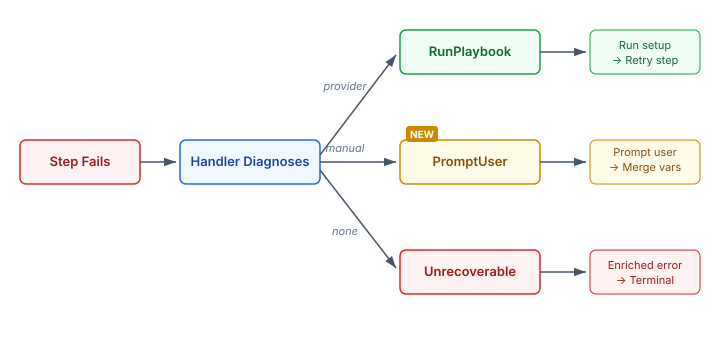

# When the User IS the Provider

The recoverable failure work gave the playbook runner a way to fix itself — a step fails because a capability isn't configured, the runner finds a setup playbook, runs it, and retries. But there's a path that couldn't be automated: the user themselves is the provider.

SMS verification where the user enters their own phone number. Email verification where they type their address. The connector knows manual resolution is possible — `ManualOption` carries the capability name — but the runner just threw up its hands: "requires manual resolution" and died. The caller had to prompt the user, collect the input, and re-invoke the entire playbook from scratch.

That re-invocation is the problem. The playbook loses its position, its variables, its state. For a simple two-step playbook it's annoying. For a registration flow with five steps where manual input happens at step two — it's a non-starter.

The fix extends the same command pattern. Handlers diagnose failures and return instructions; the runner executes them. `RunPlaybook` says "go run this setup playbook." The new `PromptUser` says "ask the user this question and give me the answer."



The critical design decision was what happens after the user responds. In the provider path, the setup playbook changes the world — configures Numbrrs, installs credentials — and the `require-capability` step must retry to detect the change. Manual input is different. The user typing their phone number IS the resolution. There's nothing for the step to re-evaluate. The input flows straight into a `manual` variable scope — `${manual.phone}`, `${manual.email}` — and subsequent steps consume it. No retry.

```java
case RecoveryAction.PromptUser pu -> {
    String input = userInputProvider.prompt(pu.promptText(), context);
    if (input == null) {
        yield RecoveryOutcome.notRecovered(/* cancelled */);
    }
    yield RecoveryOutcome.recoveredWithOutput(
            Map.of(pu.variableName(), input));
}
```

The prompt metadata — what to ask, what to call the variable — comes from the connector, not from platform code. The connector that defines the capability is the authority on what manual input looks like. When a connector adds `promptText: "Enter your phone number"` and `variableName: "phone"` to the manual option, the runner knows exactly what to ask and where to put the answer. A new capability gets its own prompts without touching any platform code.

The `UserInputProvider` SPI itself is a `@FunctionalInterface` — one method, synchronous, blocking, virtual-thread safe. MCP tools provide an implementation that sends the prompt to the client. CLI reads from stdin. REST endpoints don't provide one — blocking prompts don't fit request/response boundaries — and the runner falls back to the same `Unrecoverable` behaviour as before. Backward compatible by default.

What this opens up: the signal registration playbook can now run end-to-end with manual SMS. The user starts the playbook, hits the `require-capability` step, gets prompted for their phone number, enters it, the playbook sends a verification code to that number, and registration proceeds — all in one run, no re-invocation.
