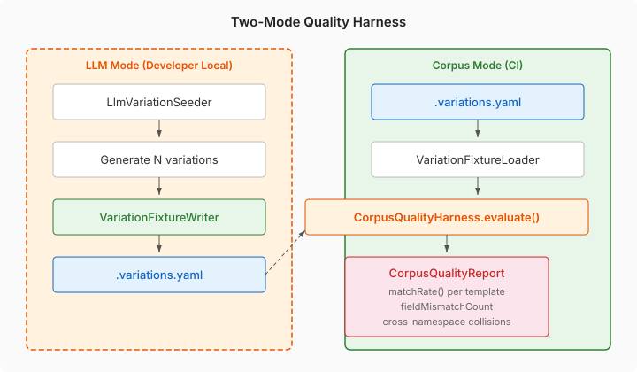

# Measuring What Templates Actually Match

Template corpora have a blind spot. Teams author patterns, deploy them, and hope they're broad enough to match what real users actually say. There's no measurement — no way to know that "I approved this architecture" matches the `vote` template but "the design looks good to me" doesn't, until a user triggers the miss in production.

We built a quality harness that closes this gap. Two modes, same evaluation logic: one generates fresh variations via an LLM and records them; the other replays those recordings deterministically in CI. The first mode is a developer tool for discovering gaps. The second is a regression gate that catches template breakage on every build.



## What "matched" actually means

A naive harness would check whether the right template name comes back. We went further — a variation only passes when both the template name AND the extracted fields are correct. A template that matches "I approved the architecture" but extracts `{decision: "approved the"}` instead of `{decision: "approve"}` has a greedy pattern. The `fieldMismatchCount` metric surfaces this without false confidence in the match rate.

Negative fixtures matter too. A hand-curated input like "the design looks good to me" that should NOT match the `vote` template is a `falsePositiveCount` if it does. The match rate itself only counts positive fixtures — negatives track a separate failure mode.

## Cross-namespace collision detection

The harder problem: a variation that matches the right template in its own namespace might also match a template in a completely different namespace. "I approved this architecture" matching both `protocol:review/vote` and `protocol:governance/endorse` is worse than a miss — it's silent ambiguity.

The harness iterates every registered namespace except the one being evaluated and checks each for a match. This catches collisions that `matchStructural()` alone would miss, since structural matching returns only the first cross-namespace hit.

## The fixture format

Variations record to a YAML format co-located with the corpus they test:

```yaml
namespace: protocol:review
fixtures:
  - template: vote
    input: "I approved this architecture"
    expectMatch: true
    expectedFields:
      decision: approve
      subject: architecture
  - template: vote
    input: "the design looks good to me"
    expectMatch: false
```

`VariationFixtureLoader` and `VariationFixtureWriter` round-trip this format. Jackson YAML handles the parsing — a deliberate new dependency in `template-registry-api` that trades the module's previous zero-dep purity for a fixture format that doesn't need a custom parser.

## The CI quality gate

A parameterized JUnit test discovers all `.variations.yaml` files on the classpath and asserts per-template thresholds:

```java
@ParameterizedTest
@MethodSource("loadFixtureFiles")
void corpusQualityGate(Path fixtureFile) {
    var report = harness.evaluate(namespace, fixtures);
    for (var template : report.templates()) {
        assertThat(template.matchRate())
            .isGreaterThanOrEqualTo(MIN_MATCH_RATE);
        assertThat(template.fieldMismatchCount()).isZero();
        assertThat(template.falsePositiveCount()).isZero();
    }
}
```

A single broken template fails CI regardless of how well others perform. The threshold is per-template, not aggregate — no averaging away a regression.

The LLM mode gets its own GitHub Actions workflow with Ollama in a service container, pulling a small model for weekly pipeline smoke tests. Not a quality assessment — just validating the full stack works end to end.
