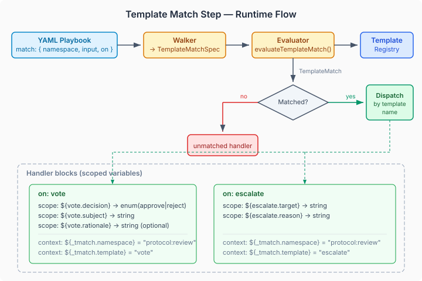

# When the Compiler Knows Your Variables

The template registry can match prose input against registered namespaces and extract typed fields. The playbook runtime can dispatch steps by pattern. What was missing: connecting the two so that a playbook author writes `${vote.decision}` and the compiler tells them, before anything runs, whether `decision` exists in the `vote` template and what type it is.

The `match` step now has a template mode. It takes free-text input, matches against a registered namespace, and dispatches to per-template handler blocks with scoped, typed variable bindings.

```yaml
- match:
    input: ${response.text}
    namespace: protocol:review
    on:
      vote:
        - invoke: recordVote
          args:
            decision: ${vote.decision}    # enum — compiler validates
            subject: ${vote.subject}       # string
      escalate:
        - invoke: routeEscalation
          args:
            target: ${escalate.target}
```

The interesting design constraint: the existing `match` step already handles value-based dispatch — `match: ${status}` with `cases:` for literal pattern matching. Rather than creating a separate `template-match` step type, we extended the same step with mode detection. When the YAML value under `match:` is a Map containing `namespace`, it's template mode. When it's a scalar with `cases:`, it's value mode. One concept, two engines.

## Compile-Time Variable Validation

The compiler resolves template namespaces via a `TemplateSchemaResolver` SPI — a functional interface that returns `List<TemplateSchema>` for a given namespace name. During compilation, it walks every handler block scanning for `${templateName.variableName}` patterns and validates each reference against the template's declared variables.

Three things it catches:

**Undeclared variables.** `${vote.nonexistent}` produces an ERROR — the template doesn't declare a variable called `nonexistent`. The diagnostic includes the available variable names, so the fix is obvious.

**Optional variable usage.** `${vote.rationale}` where `rationale` is declared with `required: false` produces a WARNING — the value may be null at runtime. Not blocking, but the author knows they're walking on thin ice.

**Cross-handler references.** `${escalate.target}` referenced inside the `vote` handler is an ERROR. Each handler's scope is isolated — `escalate` variables only exist in the `escalate` handler. This prevents a class of bugs where extracted fields from one template silently shadow or leak into another handler's context.



## Variable Scoping at Runtime

When a template matches, the evaluator pushes the extracted fields as an object scope using `withObjectScope(templateName, ...)`. Inside the `vote` handler, `${vote.decision}` resolves to the extracted enum value. A parallel `_tmatch` scope provides match metadata — `${_tmatch.namespace}`, `${_tmatch.template}`, `${_tmatch.score}` — for downstream steps that need to know what matched without being coupled to a specific template.

The underscore prefix on `_tmatch` establishes a convention for system-provided scopes. It's added to `RESERVED_CAPTURE_NAMES` so playbook authors can't accidentally shadow it with a `capture:` directive.

## Metadata on Variables

`VariableConstraint` in yaml-core gained a `metadata` field — `Map<String, String>` with known keys defined in `MetadataKeys` (PERSON, NUMBER, PRONOUNS). A template corpus can declare that the `agent` variable has `person: 3rd` and `pronouns: they/them`. This metadata flows from declaration through the schema resolver to the compiler's validation, and is queryable at runtime via the registry's schema API.

The generation step — the downstream consumer that uses metadata for grammar-aware output — is not built yet. But the data path is complete: metadata declared in YAML, carried on `VariableConstraint`, published via `TemplateSchema`, accessible through `_tmatch` context variables. When generation lands, it has everything it needs.

The `Map<String, String>` choice over a typed `GrammarHints` record was deliberate. Grammar hints are the first metadata category, not the last. Unknown keys are accepted for future extensibility; the `MetadataKeys` constants prevent typo-based silent failures for the known ones.
