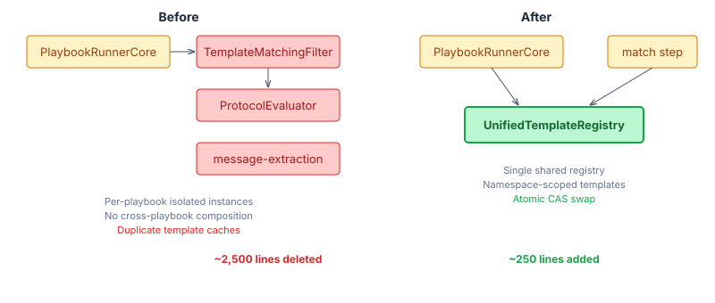
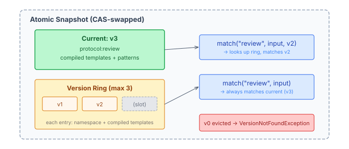

# Closing the Registry Loop

The [unified template registry](/blog/2026-11-24-mp01-unified-template-registry.md) shipped with a gap I knew was coming: the old consumers were still alive. `PlaybookRunnerCore` still created a per-playbook `TemplateMatchingFilter`, which internally spun up its own `ProtocolEvaluator` with its own compiled template cache. The new registry existed alongside the old plumbing, not instead of it.

The migration turned out to be straightforward. `PlaybookRunnerCore` already had a `templateRegistry` field — added during the `match` step work — but the `templates:` YAML section in playbooks was still wired to the old path. The fix is a private method that converts the YAML template definitions into a `TemplateNamespace` and calls `replaceOrRegister()` on the shared registry. The `StructuralStepEvaluator` already dispatches through the registry for `match` steps with `namespace:`, so the two halves connected cleanly.

What made the deletion satisfying: once `PlaybookRunnerCore` stopped creating `TemplateMatchingFilter` instances, the entire old protocol stack became dead code. `ProtocolEvaluator`, `ProtocolMatchResult`, `ProtocolInstanceKey`, `TemplateKeywords`, `NlpProtocolMatcher` — nine types in `coordination-core` with zero remaining consumers. The `message-extraction-api` and `message-extraction` modules — the extraction stack that never connected to the protocol stack — went with them. Around 2,500 lines deleted, most of it code that duplicated what the unified registry now handles in one place.

## The version problem

A second gap surfaced from an adversarial review of qhorus channel enforcement. The scenario: a COMMAND is dispatched on a channel with `protocol:review` corpus v1. The template extracts `{action: approve, ...}` and a commitment opens. Hours or days pass. The corpus is updated to v2 — a template renamed, variable constraints changed, patterns restructured. The DONE arrives, and the runtime evaluates it against v2's templates, which don't recognise the response format that was valid under v1.

In BLOCKING enforcement, this means a valid DONE gets rejected. The agent fulfilled its obligation correctly — the infrastructure broke the contract by changing the vocabulary mid-flight.

The fix has two parts. First, `TemplateNamespace` gains a monotonic version counter, assigned by the registry on each `register()` or `replaceOrRegister()`. The version flows through `TemplateMatch.Matched`, so callers — specifically the qhorus commitment code — can record which version they opened under.

Second, the `Snapshot` in `InMemoryTemplateRegistry` now keeps a bounded ring of previous namespace versions (default: 3). A new `match(namespace, input, version)` overload looks up the ring when the requested version differs from current, matching against the historical corpus. The ring is part of the atomic snapshot, so the CAS swap that installs v2 simultaneously archives v1's compiled templates — no separate data structure, no coordination gap.

The design decision was clear: match against the dispatch-time version. The agent was given a contract; the infrastructure honours it. If a commitment outlives the retention window (more than 3 corpus updates), `NamespaceVersionNotFoundException` signals an infrastructure error — the commitment was open too long for the deployment cadence. That's a capacity planning problem, not a matching problem.

The qhorus side — storing the version in commitment metadata and passing it at resolution time — is a separate change. This work provides the registry primitives; the wiring comes next.
