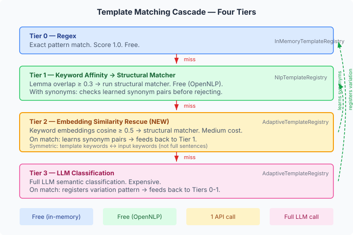
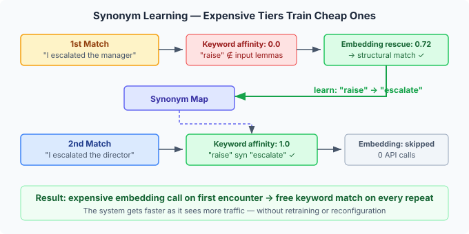

# When Keywords Aren't Enough

The template matching pipeline has a blind spot. If a template says "Raising ${target} to ${level}" and the input says "I escalated the manager to senior", keyword affinity scores zero. "Raise" and "escalate" are semantically equivalent but lexically different — different lemmas, zero overlap. The structural matcher never runs. A valid match is silently dropped.

The LLM classification tier catches these, but it's the most expensive path in the cascade. Using a full LLM call as the safety net for synonym gaps is like driving to the shop for milk when you could've had it delivered.

## The cascade that teaches itself

I designed a four-tier cascade where each tier is cheaper than the next, and expensive tiers train cheaper ones:

The new tier sits between keyword affinity and LLM classification. It computes cosine similarity between embedding vectors of the template's keywords and the input's keywords. If the similarity is high enough, the structural matcher gets its chance.

The key design decision was **symmetric comparison**. Claude caught this during the spec review — my original design compared keyword phrases against full input sentences. That's asymmetric: sentence embedding models are optimized for sentence-to-sentence comparison. Comparing "raise" (bare keyword) against "I escalated this to the manager" (full sentence) produces unreliable scores regardless of semantic relatedness. The fix: extract both sides' content lemmas (stop words removed), join into phrases, embed those. Both vectors now represent keyword-level semantics.

## Synonyms that stick

The more interesting part is what happens after a rescue. When the embedding tier catches a match that keyword affinity missed, it identifies which keywords were absent from the input and finds their nearest semantic neighbor among the input tokens. If "raise" was missing and "escalate" is the closest match above a quality threshold, that pair gets stored as a learned synonym.

Next time someone says "I escalated the director to VP", keyword affinity checks "raise" against the input, finds no direct match, checks the synonym map, finds "escalate", and passes. No embedding call needed.

The system gets faster as it sees more traffic. The first encounter pays for the embedding call; every subsequent encounter with the same synonym is a free in-memory set lookup.

## Where it lives

The original plan was to put the embedding tier directly in `NlpTemplateRegistry`. Claude's review flagged this as contradicting the module boundary established during the adaptive variation work — `template-registry` stays pure OpenNLP, `template-registry-llm` owns everything LangChain4j. The right integration point turned out to be `AdaptiveTemplateRegistry`, which already intercepts between structural matching and LLM classification. The embedding rescue slots naturally between those two calls.

Three protected accessor methods on `NlpTemplateRegistry` give the subclass what it needs: the tokenizer, the affinity threshold, and the compiled NLP templates. Minimal visibility change — the fields stay private, the accessors are protected. Same pattern `InMemoryTemplateRegistry` already uses for its snapshot methods.

## Tests as specification

The test suite for this isn't a regression safety net — it's the capability spec. Each test demonstrates a concrete scenario where the old pipeline fails and the new one succeeds: synonym gaps, paraphrases, multi-word synonyms, the learning acceleration loop, and the cross-tier coordination where embedding fails but LLM succeeds and registers a variation for next time.

Edge cases prove robustness: threshold boundaries, adversarial inputs where high embedding similarity doesn't survive the structural matcher, concurrent synonym learning, model failures that degrade gracefully. The structural matcher remains the gatekeeper — embedding is a pre-filter, not a decision maker.

For CI, the simulation framework replays recorded embeddings from real local model runs. A Maven profile runs against Ollama, records the responses, and commits the corpus. CI replays without needing a running model — same assertions, same data shapes, no infrastructure dependency.

The design is done. Implementation is next session's work — eight tasks across five batches, starting with the API changes and synonym-aware keyword affinity, building up through the core cascade, and finishing with the capability proof test suite.
